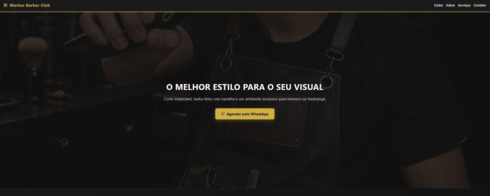
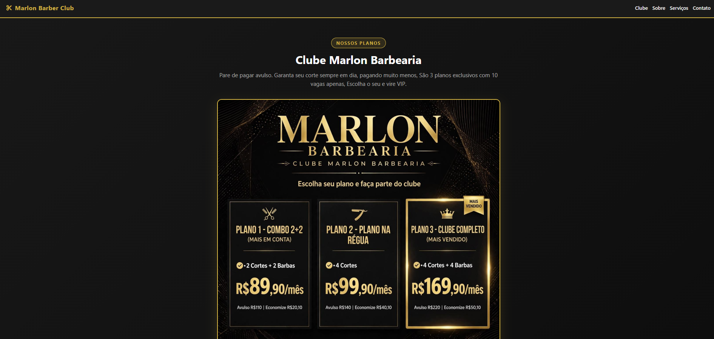
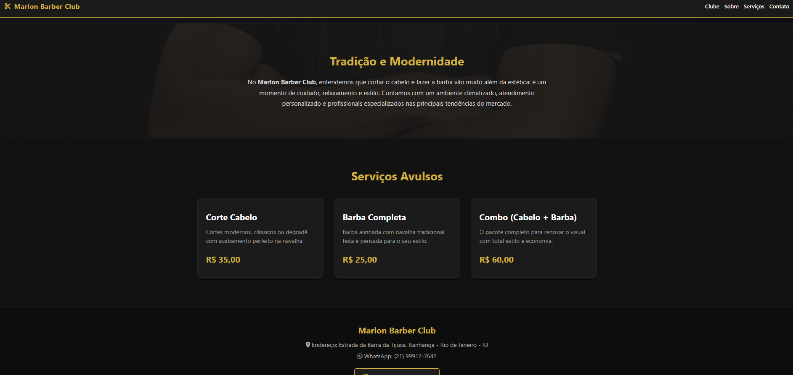

# Marlon Barber Club

Landing page da **Marlon Barber Club**, criada para apresentar a barbearia de forma objetiva e facilitar o acesso dos clientes a planos, serviços, localização, contato e agendamento pelo WhatsApp.

## Objetivo

O projeto funciona como uma vitrine digital responsiva para a barbearia. A página reúne as informações essenciais do negócio em uma única experiência, com destaque para o Clube Marlon e para o contato direto pelo WhatsApp.

## Funcionalidades visíveis

- Hero inicial com apresentação da barbearia e botão **Agendar pelo WhatsApp**.
- Navegação interna para as seções Clube, Sobre, Serviços e Contato.
- Apresentação dos planos do Clube Marlon com chamada para adesão via WhatsApp.
- Seção institucional sobre a proposta e o atendimento da barbearia.
- Lista de serviços avulsos — corte de cabelo, barba completa e combo — com preços.
- Informações de endereço e WhatsApp.
- Link para o Instagram da barbearia.
- Layout responsivo para celular, tablet e desktop.

## Tecnologias utilizadas

- **HTML5** para a estrutura e o conteúdo da página.
- **CSS3** para layout, responsividade, cores, tipografia e efeitos visuais.
- **Font Awesome 6.4.0**, carregado por CDN, para os ícones da interface.
- **GitHub Pages** como opção de publicação do site estático, conforme o domínio configurado em `CNAME`.

Não há JavaScript no projeto e não há back-end próprio: o site é um front-end estático. Os agendamentos e dúvidas são direcionados para o WhatsApp por links externos.

## Estrutura do projeto

```text
.
├── index.html              # Página principal
├── style.css               # Estilos e regras de responsividade
├── marlon-1.jpg            # Imagem da seção Sobre
├── marlon-2.jpg            # Imagem de fundo do hero
├── clube-marlon.jpg        # Imagem dos planos do clube
├── CNAME                   # Domínio usado na publicação
├── docs/
│   └── images/             # Screenshots para a documentação
└── README.md
```

## Como executar localmente

### 1. Clonar o repositório

```bash
git clone https://github.com/thainnaragarces-web/barbearia.git
cd barbearia
```

### 2. Abrir a página

Como não há dependências ou etapa de build, é possível abrir `index.html` diretamente no navegador.

Para servir os arquivos localmente por HTTP, também é possível usar o servidor simples do Python:

```bash
python -m http.server 8000
```

Depois, acesse <http://localhost:8000>.

## Galeria

### Hero e agendamento



*Tela inicial com a apresentação da barbearia e o botão de agendamento pelo WhatsApp.*

### Planos do Clube Marlon



*Destaque para os planos de assinatura e a chamada para entrar no clube.*

### Serviços e contato



*Visualização dos serviços oferecidos e das informações de contato.*

## Publicação

O projeto pode ser publicado como site estático no GitHub Pages. O arquivo `CNAME` mantém o domínio personalizado `marlonbarberclub.me` quando essa publicação está habilitada.
